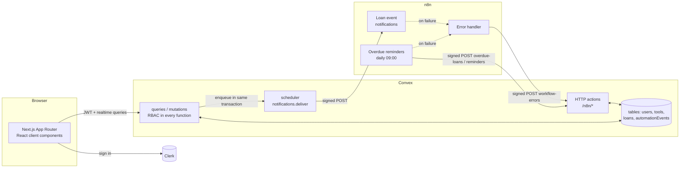

# LendLoop

> **Borrow what you need. Lend what you don't.**

A neighbourhood tool-lending board. Neighbours list tools, request to borrow
them for a date range, and approve, decline and close out loans. n8n
workflows handle notifications and overdue reminders, and Convex verifies
everything n8n sends back to it.

**Stack:** Next.js 15 (App Router) · TypeScript · Clerk · Convex · n8n (self-hosted, Docker) · Tailwind v4 · Vitest + convex-test

---

## Contents

1. [What it does](#what-it-does)
2. [Local setup](#local-setup)
3. [Environment variables](#environment-variables)
4. [Architecture](#architecture)
5. [Roles and access control](#roles-and-access-control)
6. [n8n integration](#n8n-integration)
7. [Security and data-minimisation decisions](#security-and-data-minimisation-decisions)
8. [Testing](#testing)
9. [What I'd change for production](#what-id-change-for-production)

---

## What it does

| Area | Features |
| --- | --- |
| **Public page** (`/`) | Tagline. Read-only list of *available* tools showing **name + category only**, served by a public Convex query that never selects owner data. "Sign in to lend or borrow" button (Clerk). |
| **Browse** (`/dashboard`) | All tools with availability status (Available / On loan), filterable by category. Shows condition, description, lender's first name, a ✓ Trusted Lender badge and booked date ranges. Request to borrow for a date range. |
| **My listings** | Create, edit and delete your own tools (name, category, condition, short description). Shows pending-request counts. |
| **My requests** | Loans you asked for, with status and automation activity ("Overdue reminder sent 2 days ago"). Cancel pending requests. |
| **Incoming requests** | Approve or decline requests for your tools, and mark loans as returned. |
| **Admin** (`/dashboard/admin`) | Remove any listing, view all loans, mark or unmark Trusted Lenders, and see failed automation runs. |

Business rules (enforced server-side): you can't borrow your own tool;
loans start no earlier than today, last at most 30 days, and are booked at
most 90 days ahead. Approving a loan blocks double-booking and
auto-declines overlapping pending requests. A listing with an active loan
can't be deleted by its owner. Deleting a listing cancels its pending
requests and notifies the borrowers.

Abuse limits (also server-side, since every request notifies a lender):
at most 10 borrow requests per hour and 10 unanswered requests per
borrower, at most 15 pending requests per tool (even across accounts),
and at most 10 new listings per hour and 50 in total per user.

---

## Local setup

### Prerequisites

- Node.js 20+ and npm
- Docker (for n8n)
- A free [Clerk](https://clerk.com) application
- A [Convex](https://convex.dev) account. Optional: `npx convex dev` can also run a local, account-less backend.

### 1. Install

```bash
npm install
```

### 2. Clerk

1. Create a Clerk application. Copy its **Publishable key** and **Secret key**.
2. Connect Clerk to Convex. In the Clerk dashboard, either activate the
   **Convex integration** or create a **JWT template** named `convex`.
3. Make sure the token carries the claims LendLoop reads: `name`, `email` and
   `email_verified`. The `convex` JWT template preset includes them. With the
   native integration, add them under *Sessions → Customize session token*.
   **`email_verified` is required:** an address is only stored, and only
   receives notifications, when the token says it is verified.
   ```json
   { "name": "{{user.full_name}}", "email": "{{user.primary_email_address}}", "email_verified": "{{user.email_verified}}" }
   ```
4. Note your **Frontend API URL / issuer**, e.g. `https://your-app-12.clerk.accounts.dev`.

### 3. Convex

```bash
npx convex dev        # creates the deployment, writes .env.local, pushes functions, keeps watching
```

In a second terminal, set the server-side environment variables on the
Convex deployment:

```bash
npx convex env set CLERK_JWT_ISSUER_DOMAIN https://your-app-12.clerk.accounts.dev
```

```bash
npx convex env set LENDLOOP_TO_N8N_SECRET "$(openssl rand -hex 32)"
```

```bash
npx convex env set N8N_TO_LENDLOOP_SECRET "$(openssl rand -hex 32)"
```

```bash
npx convex env set N8N_NOTIFY_WEBHOOK_URL http://localhost:5678/webhook/lendloop-loan-events
```

> `N8N_NOTIFY_WEBHOOK_URL` must be reachable **from the Convex backend**.
> `localhost` works with a local Convex backend. A cloud deployment needs a
> public URL. Expose the **webhook gateway** on port 8080, never n8n's own
> port 5678: the gateway forwards only `POST /webhook/lendloop-loan-events`
> and returns 404 for the editor, the API and everything else. For example,
> run `cloudflared tunnel --url http://localhost:8080` and set
> `N8N_NOTIFY_WEBHOOK_URL` to `https://<tunnel-host>/webhook/lendloop-loan-events`.

### 4. Next.js

Add the Clerk keys to `.env.local` (see `.env.example`), then:

```bash
npm run dev
```

Open <http://localhost:3000> and sign in once.

### 5. Make yourself an admin and add demo data

Roles can only be changed with deployment credentials, never from the
browser. Accounts are addressed by id, not email. Find yours:

```bash
npx convex run admin:listAccounts
```

```bash
npx convex run admin:setRole '{"userId":"<your userId>","role":"admin"}'
```

```bash
npm run seed
```

`npm run seed` adds three demo neighbours with six tools. Their addresses use
the reserved `example.com` domain.

### 6. n8n

```bash
cp n8n/.env.example n8n/.env
```

Create the key that encrypts n8n's stored credentials. It's a Docker secret
file rather than an environment variable, so workflows can't read it:

```bash
openssl rand -hex 32 > n8n/secrets/n8n_encryption_key
```

Fill in `n8n/.env`:

- `LENDLOOP_TO_N8N_SECRET` and `N8N_TO_LENDLOOP_SECRET`: the same values you set on Convex. Read them back with `npx convex env get <NAME>`.
- `CONVEX_SITE_URL`: your Convex **HTTP actions** URL (`https://<deployment>.convex.site`), or `http://host.docker.internal:3211` for a local backend.

```bash
docker compose -f n8n/docker-compose.yml up -d
```

On first start a one-shot `n8n-import` container imports **and publishes** the
three workflows from `n8n/workflows/`. It runs once per volume. To pick up
changed workflow files later, recreate the volume with
`docker compose -f n8n/docker-compose.yml down -v` (this also deletes n8n's
execution history and owner account). Open <http://localhost:5678> and create
the n8n owner account. Keep it the only account that can edit workflows (see
[Security of the integration](#security-of-the-integration)).

| Service | Address | Purpose |
| --- | --- | --- |
| `n8n` | `127.0.0.1:5678` | Editor, API and webhooks. Local only. |
| `webhook-gateway` (Caddy) | `127.0.0.1:8080` | The only thing to expose publicly: forwards `POST /webhook/lendloop-loan-events` (≤ 64 KB) and nothing else. |

### 7. Try the automations

- **Request notification:** request a demo tool in the app. The loan card
  shows "⚙ Notified (requested) just now", and the n8n execution log shows
  the composed message.
- **Overdue reminder:** run `npm run seed:overdue`, then in n8n open
  *LendLoop: overdue reminders* and click **Test workflow** (or wait for 09:00).
  Run it again: no second reminder is sent. CLI alternative:
  `docker compose -f n8n/docker-compose.yml exec -e N8N_RUNNERS_BROKER_PORT=5690 n8n n8n execute --id=lendloopRemind01`
- **Failure handling:** restart n8n with `SIMULATE_NOTIFY_FAILURE=true`
  (`SIMULATE_NOTIFY_FAILURE=true docker compose -f n8n/docker-compose.yml up -d n8n`).
  Then request a tool. n8n fails and returns 500, and Convex retries with
  backoff. The error workflow records each failed run, and the admin page
  lists them. Restart without the flag and the pending notification goes
  through on its next retry.

---

## Environment variables

| Variable | Where | Purpose |
| --- | --- | --- |
| `NEXT_PUBLIC_CONVEX_URL`, `CONVEX_DEPLOYMENT` | `.env.local` | Written by `npx convex dev`. |
| `NEXT_PUBLIC_CLERK_PUBLISHABLE_KEY`, `CLERK_SECRET_KEY` | `.env.local` | Clerk API keys. |
| `CLERK_JWT_ISSUER_DOMAIN` | Convex env | Issuer Convex trusts for Clerk JWTs (`convex/auth.config.ts`). |
| `LENDLOOP_TO_N8N_SECRET` | Convex env **and** `n8n/.env` | HMAC key for Convex → n8n webhook calls. |
| `N8N_TO_LENDLOOP_SECRET` | Convex env **and** `n8n/.env` | HMAC key for n8n → Convex HTTP endpoints. |
| `N8N_NOTIFY_WEBHOOK_URL` | Convex env | n8n production webhook URL for loan events. |
| `CONVEX_SITE_URL` | `n8n/.env` | Convex HTTP actions base URL. |
| `n8n_encryption_key` | `n8n/secrets/` (Docker secret file) | Encrypts n8n's credential store. Mounted as a file via `N8N_ENCRYPTION_KEY_FILE`, so it's not in the environment and workflows can't read it. |
| `GENERIC_TIMEZONE` | `n8n/.env` | Timezone for the daily schedule (default UTC). |
| `SIMULATE_NOTIFY_FAILURE` | `n8n/.env` (optional) | `true` makes the mock channels throw, to demo retries and error handling. |

All `.env*` files except the `.env.example` templates, and everything in
`n8n/secrets/`, are git-ignored. Exported
workflow JSON only references `$env.<NAME>`. No secret appears in the repository.

---

## Architecture



```
app/                     Next.js routes
  page.tsx               public landing page + public tool list
  dashboard/             signed-in area (layout provisions the user record)
    page.tsx             browse + request
    listings/ requests/ incoming/ admin/
components/              Providers (Clerk + Convex), Header, LoanCard, ui primitives
convex/
  schema.ts              tables + indexes
  lib/auth.ts            getViewer / requireViewer / requireAdmin / assertOwnsTool
  lib/signing.ts         HMAC sign/verify (timestamped, constant-time)
  lib/dates.ts           loan date rules
  lib/limits.ts          per-account abuse limits
  users.ts tools.ts loans.ts admin.ts
  notifications.ts       outbox → signed webhook → retry/backoff
  automation.ts          internal functions behind the n8n endpoints
  http.ts                signed HTTP endpoints for n8n
  seed.ts                demo data
  *.test.ts              convex-test suites
middleware.ts            Clerk route protection for /dashboard
n8n/
  docker-compose.yml     n8n + one-shot import/publish + webhook gateway
  Caddyfile              gateway: only the loan-events webhook is public
  workflows/*.json       exported workflows
```

**Data model**

- `users`: `tokenIdentifier` (Clerk issuer + subject), display `name`, `email` (for notifications only), `role` (`admin` | `user`), `trustedLender`.
- `tools`: `ownerId`, `name`, `category`, `condition`, `description`.
- `loans`: `toolId`, a `toolName` snapshot (history survives a deleted listing), `ownerId`, `borrowerId`, inclusive ISO `startDate`/`endDate`, and `status`.
- `automationEvents`: one row per notification, reminder or workflow error. Holds `idempotencyKey` (unique), `status` (`pending` | `succeeded` | `failed`), `attempts` and non-PII `detail`. It is the audit trail behind "Reminder sent 2 days ago" and the admin failure panel.

**Loan state machine**

```
requested ──approve (lender)──▶ approved ──markReturned (lender)──▶ returned
    ├──decline (lender)──▶ declined
    └──cancel (borrower)──▶ cancelled
```

Dates are ISO strings (`YYYY-MM-DD`, UTC), so string order equals date
order. That lets the `by_status_endDate` index answer "approved loans that
ended before today" directly.

---

## Roles and access control

- **Enforced in Convex, not just the UI.** Every public query and mutation starts with `requireViewer` or `requireAdmin` (`convex/lib/auth.ts`). Ownership checks compare the caller's user id with the document's `ownerId` / `borrowerId`. Hidden buttons and Next.js middleware are conveniences only. The test suite calls the functions directly as other users to prove they refuse.
- **What each role can do:**
  - `user`: create, edit and delete *own* listings. Request loans. Cancel *own* requests. Approve, decline or mark returned only on loans for *own* tools.
  - `admin`: remove *any* listing (pending requests are cancelled and borrowers notified), view all loans and users, toggle Trusted Lender, see automation failures. Admins deliberately can't edit other people's listings or act on their loans. Moderation means removal, not impersonation.
- **No self-elevation.** `users.ensureViewer` creates or refreshes the user from the verified JWT but never touches `role` or `trustedLender`. Roles change only through `admin:setRole`, an **internal** mutation that clients can't call, run with deployment credentials (CLI or dashboard). It takes a user **id**, not an email, so a look-alike or unverified address can't get the wrong account promoted.
- **Why roles live in Convex rather than Clerk metadata:** the data and the checks live in the same place, changes take effect immediately (no token refresh), and a single source of truth is easy to audit. Mirroring the role into Clerk `publicMetadata` for SSR would be a reasonable addition.
- **Typed errors.** Functions throw `ConvexError({ code, message })` (`UNAUTHENTICATED`, `FORBIDDEN`, `NOT_FOUND`, `INVALID_INPUT`, `CONFLICT`), which the UI shows inline.

---

## n8n integration

### Workflows (`n8n/workflows/`)

| Workflow | Trigger | Steps |
| --- | --- | --- |
| **LendLoop: loan event notifications** | Webhook `POST /webhook/lendloop-loan-events` (raw body kept) | Verify HMAC and timestamp → drop already-delivered `eventId`s → compose message → send (mock channel) → remember `eventId` → respond 200. Invalid signature → 401. |
| **LendLoop: overdue reminders** | Schedule, daily 09:00 (plus a manual "Run now" trigger) | Sign → `POST /n8n/overdue-loans` (one page) → one item per loan → send reminder (mock; per-item try/catch) → sign → `POST /n8n/reminders` with `sent` or `failed`. **More pages?** loops back with the cursor until there are no more pages (at most 50). |
| **LendLoop: error handler** | Error Trigger (both workflows set it as their `errorWorkflow`) | Summarise, redact emails, sign → `POST /n8n/workflow-errors`. |

The notification channel is a **logged mock**: it logs a masked address and
the subject. Swapping it for Send Email, Slack or Discord is a one-node
change. The composed message already contains only what the recipient needs.

### Request notifications: Convex → n8n

1. A loan mutation calls `enqueueLoanNotification` **inside the same
   transaction** as the status change. This is a transactional outbox: the
   `automationEvents` row exists if and only if the transition committed.
   Its key `notify:<loanId>:<type>` makes enqueueing idempotent.
2. The scheduler runs `notifications.deliver`. It builds a **minimal**
   payload (recipient's first name and email, the other party's first name,
   tool name, dates, status) and POSTs it with:
   `x-lendloop-timestamp`, `x-lendloop-signature: v2=HMAC_SHA256(secret, "<ts>\n<METHOD>\n<path>\n<body>")`,
   `idempotency-key: <eventId>`. The request times out after 10 s. The
   same scheme, with the other secret, signs every n8n → Convex call.
3. **Retries:** 5xx, 408, 429 and network errors are retried after 10 s,
   1 min, 5 min and 30 min (5 attempts). Other 4xx responses (e.g. a bad
   signature) aren't retried. After the last attempt the event is marked
   `failed` and appears on the admin page.
4. n8n verifies the signature over the **raw bytes**, in constant time,
   with a ±5 min window. It acknowledges duplicate `eventId`s without
   notifying again. Delivery is at-least-once from Convex and effectively
   once to the user.

### Overdue reminders: n8n → Convex

- `POST /n8n/overdue-loans` returns approved loans whose `endDate` is before
  today. Each comes with a `reminderKey` of `reminder:<loanId>:<YYYY-MM-DD>`
  and only the fields a reminder needs. **Loans already reminded today are
  excluded**, so re-running the workflow is harmless.
- It returns **one page** (100 loans) and a `nextCursor`. The workflow sends
  the cursor back with the same `asOf` until the cursor is `null`, so no
  loan is dropped however many are overdue.
- A loan whose borrower has **no verified email** can't be reminded. Convex
  records it as a failed reminder ("No verified email on file") instead of
  skipping it, so it shows on the admin page and the loan card. Only the
  count reaches n8n.
- `POST /n8n/reminders` is an **idempotent upsert** keyed by `reminderKey`.
  It returns `created`, `updated` (a failed attempt later succeeded) or
  `duplicate` (already succeeded, so it does nothing). The key must belong
  to the `loanId` in the body, otherwise the request is rejected with 422.
- Both HTTP Request nodes retry 3× (5 s apart). Their write-backs are
  idempotent, so retries are safe.

### Failure visibility

- n8n: both workflows point at **LendLoop: error handler**. It writes a
  `workflow_error` event to Convex, deduplicated per execution id. n8n
  keeps failed executions, and executions older than 7 days are pruned.
- Convex: failed deliveries and failed reminders are recorded with their
  attempt count and reason. **Admin → Automation failures** lists all three
  kinds. Every loan card shows its last few automation events.

### Security of the integration

- **Two secrets, one per direction.** A leak on one side doesn't let an attacker forge the other.
- Signatures cover a timestamp, which limits replay to a 5-minute window. n8n deduplicates `eventId`s and Convex is idempotent, so a replay inside the window changes nothing.
- Signatures also cover the **method and path**. A request signed for one endpoint is rejected by every other endpoint, even one that shares the secret. Each side checks against the path it serves, not the path in the request.
- Convex's endpoints return a generic 401 and log the specific reason only server-side. Bodies are validated with **strict** zod schemas after verification, so unexpected keys are rejected (400) rather than silently dropped.
- Secrets live in Convex env vars and `n8n/.env`. Code nodes read the two HMAC secrets via `$env`, so the exported JSON has none. In n8n 2.x this needs `N8N_BLOCK_ENV_ACCESS_IN_NODE=false`, which lets anyone who can *edit* workflows read those two values. Keep workflow-edit rights to the owner account.
- n8n's credential-encryption key is **not** in the environment. It's a Docker secret file (`N8N_ENCRYPTION_KEY_FILE`). Verified with a probe workflow: `$env` doesn't expose it, the Read/Write Files node is refused access to the file, and `require('fs')` is disallowed in Code nodes.
- Only the webhook is public. n8n binds to localhost, and the Caddy gateway forwards nothing but `POST /webhook/lendloop-loan-events`, with a 64 KB body cap.

---

## Security and data-minimisation decisions

- **Public data:** the public query returns `{ id, name, category }` and nothing else. No owner, condition or description, and tools on loan are hidden.
- **Between users:** other people appear by **first name only**. Emails are never returned to any client, admins included. Users coordinate through notifications, not by exchanging contact details.
- **To n8n:** payloads include only the recipient's first name and email, the other party's first name and loan facts. No user ids beyond the loan id, no other party's email, no descriptions.
- **Inside n8n:** logs mask addresses (`b***@example.com`). The error workflow strips email addresses from error messages before sending them to Convex. Execution data is pruned after 7 days.
- **Only verified emails are stored.** An address is kept only when the token says `email_verified: true`. A missing claim counts as unverified, so notifications can't be pointed at someone else's address.
- **Abuse limits** on requests and listings (see [What it does](#what-it-does)) stop one account from flooding a lender with notifications.
- **Input validation:** Convex validators on every argument, with length limits on text, strict calendar-date parsing, and enum categories, conditions and roles.
- **Defence in depth:** Clerk middleware protects `/dashboard`, but every function also checks auth independently.
- **Browser hardening:** a strict Content-Security-Policy with a fresh nonce per request (`'strict-dynamic'`), set by Clerk's middleware and extended with the Convex origins. Only Next.js's and Clerk's own scripts can run. `frame-ancestors 'none'` and `X-Frame-Options: DENY` stop clickjacking of buttons like Approve and Remove. Also `nosniff`, a strict `Referrer-Policy`, a restrictive `Permissions-Policy`, and HSTS in production.
- **Bounded reads:** the catalogue is paged, with the page size capped at 50 on the server, so one request can't make Convex read the whole table.
- **Supply chain / runtime:** React pinned to a patched 19.1.x. The n8n image is pinned to a fixed version and n8n is bound to `127.0.0.1` in compose. n8n telemetry is off.

---

## Testing

```bash
npm test            # 39 tests: unit (dates, HMAC) + convex-test integration
```

```bash
npm run typecheck
```

```bash
npm run lint
```

The integration suite (`convex/lendloop.test.ts`) runs the real Convex
functions in memory as different identities. It covers:

- The public query exposes only name and category. The catalogue is paged, every tool is reachable through the cursor, and the page size is capped.
- Signed-out callers are rejected.
- Users can't edit, delete or act on others' listings and loans. Admins can remove any listing. Users can't self-promote, and admin functions reject users.
- The lifecycle rules work: double booking is blocked, overlapping requests are auto-declined, and you can't borrow your own tool.
- Loan views never contain emails.
- Emails are stored only when verified (a missing claim counts as unverified), and roles are granted by user id.
- Abuse limits: hourly and open-request caps per borrower, a per-tool pending cap across accounts, and hourly and total listing caps.
- Each transition sends exactly one **signed** webhook with a minimal payload, and the signature is bound to the webhook path.
- 5xx responses are retried 5× then marked failed and shown to admins. 4xx responses aren't retried.
- n8n endpoints reject bad signatures, signatures made for another endpoint, and bodies with unexpected keys. The overdue list is minimal, and reminder write-backs are idempotent and scoped to their loan.
- Overdue loans are paged with a cursor: 106 loans are walked with none missed or repeated. Loans whose borrower has no email are recorded as failed reminders and shown to admins.
- Workflow errors are deduplicated.

I also ran the whole loop against a real n8n 2.47.5 container:

- **Signed webhook:** 200. **Replay:** "duplicate". **Bad, stale or tampered signature:** 401. **Signature made for another path, or an old `v1` signature:** 401, in both directions.
- **Reminders, run twice:** created, then nothing to do. With the page size temporarily set to 2, the workflow walked 3 pages (2 + 2 + 1 loans) and the second run walked them again without sending anything.
- **CSP:** in a browser, every script tag carries the request's nonce, and the page hydrates and talks to Convex with no CSP violations.
- **Simulated outage:** Convex retries and the error workflow records each failed run. Recovery happens on the next retry.
- **Webhook gateway:** the signed webhook passes. The editor, `/rest`, `/api`, other webhooks, `/webhook-test` and `../` traversal all return 404, and a 70 KB body returns 413.
- **Secret isolation:** a probe Code node can't see the encryption key in `$env`, can't read its file with the Read/Write Files node, and can't load `fs`.

---

## What I'd change for production

**Secrets and keys**

- Move the two HMAC secrets from `$env` to n8n **External Secrets** (Vault / AWS Secrets Manager) and re-enable `N8N_BLOCK_ENV_ACCESS_IN_NODE`.
- Rotate the HMAC secrets on a schedule. Support two active keys during rotation, with a key id in the signature header.
- Add a nonce cache on the Convex endpoints so a captured request can't be replayed even inside the 5-minute window (audit finding LL-06).

**n8n**

- Run n8n on **Postgres** in queue mode with workers, external task runners and backups. Add SSO and least-privilege roles for workflow editors.
- Expose only the webhook path publicly, behind TLS and a WAF or rate limit. Keep the editor on a private network.

**Notifications and reminders**

- Use a real channel: transactional email (SES / Postmark) with templates, unsubscribe handling and bounce processing. Keep the n8n-side idempotency store in Postgres or Redis rather than workflow static data.
- Add an n8n-side dead-letter queue and alerting (Slack or PagerDuty) from the error workflow, in addition to the Convex record.
- Store user timezones and send reminders at a local hour. Escalate after N days overdue.

**Data and scale**

- Page the admin views too (they show the latest 200 loans and 500 users). Denormalise tool availability onto `tools` if the catalogue grows: the public catalogue skips on-loan tools after reading each page, so pages can come back short.
- Add a CSP `report-to` endpoint to collect violation reports.
- Retention policy for `automationEvents` and loan history, plus user data export and deletion (GDPR/CCPA). Handle Clerk `user.deleted` webhooks to anonymise users.

**Abuse and auditing**

- Move the fixed abuse limits to a token-bucket limiter (e.g. `@convex-dev/rate-limiter`) with per-lender limits, and let lenders block a borrower. Add content moderation for listing text.
- Write an audit log for admin actions (who removed which listing, who changed trust or roles, and when).

**Observability and delivery**

- Sentry for the Next.js app and Convex functions, with log streaming to Datadog. Track n8n execution metrics and alert on a rising failure rate.
- CI: lint, typecheck, tests, `convex deploy` with preview deployments, and a Playwright smoke test across the main flows.
